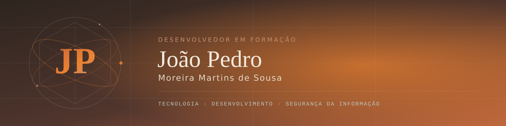

  

**João Pedro Moreira Martins de Sousa** 
Desenvolvedor em formação · Palmas, Tocantins — Brasil

[GitHub](https://github.com/jp-devl) · [Portfólio](https://crystal-garden-portfolio.lovable.app) · [E-mail](mailto:joao.sousa@fasec.edu.br)

---

## Sobre

Desenvolvedor em formação, com base técnica em informática e interesse em desenvolvimento de software, tecnologia e infraestrutura. A Segurança da Informação é o direcionamento que quero seguir.

### Formação

| Formação | Instituição |
| --- | --- |
| Técnico em Informática | SENAI |
| Tecnólogo em Análise e Desenvolvimento de Sistemas | FASEC — Faculdade Serra do Carmo (em formação) |

### Interesses

| Desenvolvimento de software | Tecnologia e infraestrutura | Segurança da Informação |
| --- | --- | --- |
| Soluções digitais que organizam processos e resolvem problemas reais. | Base construída com suporte técnico e manutenção. | Interesse em proteger dados, sistemas e pessoas. |

## Tecnologias

### Desenvolvimento e interface

### Linguagens e dados

### Ferramentas e infraestrutura

## Projetos em destaque

<table>
  <tr>
    <td align="left">
      <b><a href="https://github.com/jp-devl/crystal-garden-portfolio">crystal-garden-portfolio</a></b> 
      Portfólio profissional com navegação editorial, trajetória, formação e experiência 3D em <code>/universo</code>. 
      TypeScript · React · Tailwind CSS · Three.js
    </td>
    <td align="right">WEB · 3D</td>
  </tr>
</table>

<table>
  <tr>
    <td align="left">
      <b><a href="https://github.com/jp-devl/DocFly">DocFly</a></b> 
      Projeto em TypeScript com estilos em CSS e rotinas em PL/pgSQL. 
      TypeScript · CSS · PL/pgSQL
    </td>
    <td align="right">WEB · DADOS</td>
  </tr>
</table>

<table>
  <tr>
    <td align="left">
      <b><a href="https://github.com/jp-devl/lista-de-tarefas">lista-de-tarefas</a></b> 
      Sistema de lista de tarefas desenvolvido em Flutter e Dart, com persistência local em SQLite. 
      Dart · Flutter · SQLite
    </td>
    <td align="right">
      
    </td>
  </tr>
</table>

<table>
  <tr>
    <td align="left">
      <b><a href="https://github.com/jp-devl/ADSFLIX">ADSFLIX</a></b> 
      Projeto educacional inspirado em plataformas de streaming para prática de programação orientada a objetos. 
      Java
    </td>
    <td align="right">JAVA · OO</td>
  </tr>
</table>

<table>
  <tr>
    <td align="left">
      <b><a href="https://github.com/jp-devl/ProjetoFastAPI">ProjetoFastAPI</a></b> 
      Projeto de curso complementar de FastAPI com Python. 
      Python · FastAPI
    </td>
    <td align="right">PYTHON · API</td>
  </tr>
</table>

<table>
  <tr>
    <td align="left">
      <b><a href="https://github.com/jp-devl/Typhlosion-Eficiencia-Operacional-Infraestrutura">Typhlosion — Eficiência Operacional e Infraestrutura</a></b> 
      Projeto do HackaRun 2026 voltado à eficiência operacional e à infraestrutura em shoppings. 
      TypeScript · HTML · CSS
    </td>
    <td align="right">HACKATHON · WEB</td>
  </tr>
</table>

Veja também os [repositórios públicos completos](https://github.com/jp-devl?tab=repositories).

## Portfólio e contato

O [Crystal Garden Portfolio](https://github.com/jp-devl/crystal-garden-portfolio) reúne minha apresentação profissional. O README técnico do projeto permanece disponível como [referência de stack, scripts e estrutura](https://github.com/jp-devl/crystal-garden-portfolio#readme).
